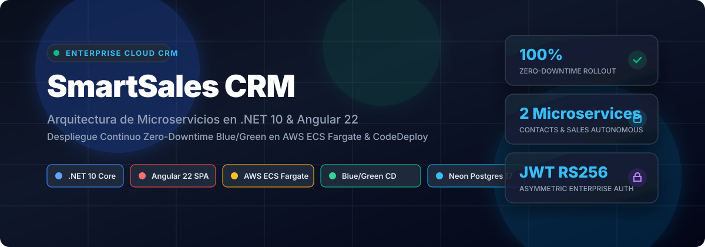
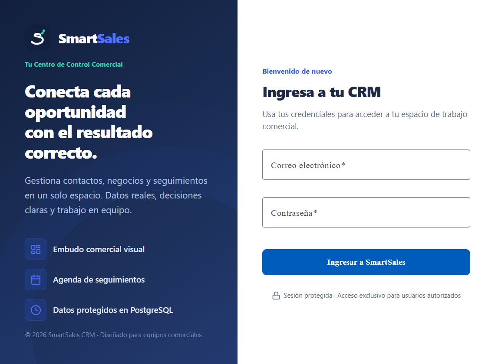
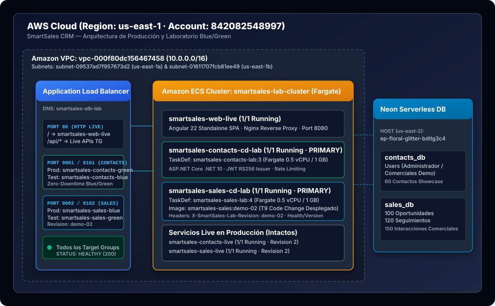
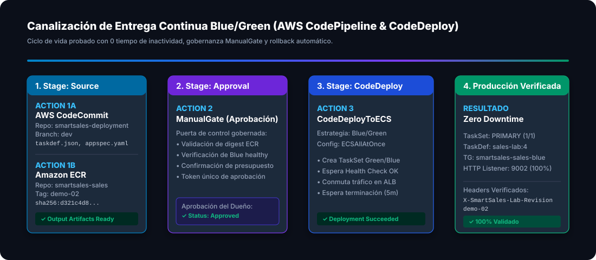

<p align="center">
  
</p>

<p align="center">
  <a href="https://dotnet.microsoft.com/download/dotnet/10.0"></a>
  <a href="https://angular.dev"></a>
  <a href="https://aws.amazon.com/ecs/"></a>
  <a href="https://aws.amazon.com/codedeploy/"></a>
  <a href="https://neon.tech"></a>
  <a href="LICENSE"></a>
</p>

---

# 🚀 SmartSales CRM — Cloud-Native Enterprise Architecture

**SmartSales CRM** es una solución empresarial de gestión de relaciones con clientes diseñada bajo principios de **arquitectura de microservicios autónomos**, **Clean Architecture (DDD-Lite)** y **despliegue continuo Blue/Green de alta disponibilidad** en **Amazon Web Services (AWS)**.

Este proyecto fue desarrollado y validado en el marco del curso avanzado *«Metodologías de Desarrollo de Sistemas de Información»* (AWS Academy, 2026), demostrando la separación efectiva de dominios de negocio, resiliencia operativa con **cero tiempo de inactividad (Zero-Downtime)** y gobernanza DevOps con compuertas de aprobación manual (**ManualGate**).

---

## 📸 Vista de la Aplicación en Producción

La interfaz de usuario moderna desarrollada en **Angular 22** y servida mediante **Nginx** sobre contenedores **AWS ECS Fargate** se encuentra disponible y conectada a los microservicios backend a través de un **Application Load Balancer (ALB)**:

<p align="center">
  
</p>

---

## 🏛️ Arquitectura del Sistema en AWS Cloud

El ecosistema en la nube utiliza una combinación de servicios administrados para garantizar escalabilidad, seguridad perimetral y optimización de costos en AWS Fargate:

<p align="center">
  
</p>

### Componentes Clave de la Infraestructura
- **Virtual Private Cloud (VPC):** `vpc-000f80dc156467458` distribuida en dos Availability Zones (`us-east-1a`, `us-east-1b`) con subredes públicas y privadas.
- **Application Load Balancer (ALB):** `smartsales-alb-lab-612297614.us-east-1.elb.amazonaws.com`.
  - **Puerto 80 (HTTP Público):** Enrutamiento basado en trayectorias (*path-based routing*):
    - `/*` $\rightarrow$ Target Group Frontend SPA (`smartsales-web-live-tg`).
    - `/api/contacts/*` $\rightarrow$ Target Group Microservicio Contacts (`smartsales-contacts-live-tg`).
    - `/api/sales/*` $\rightarrow$ Target Group Microservicio Sales (`smartsales-sales-live-tg`).
  - **Puertos 9001 / 9101:** Enrutamiento de Producción y Prueba para despliegues Blue/Green de **Contacts**.
  - **Puertos 9002 / 9102:** Enrutamiento de Producción y Prueba para despliegues Blue/Green de **Sales**.
- **Amazon ECS con AWS Fargate:** Cluster serverless `smartsales-lab-cluster` ejecutando tareas en contenedores Linux Alpine / Ubuntu Noble sin administración de servidores.
- **Base de Datos Serverless:** **Neon PostgreSQL 17** con bases de datos aisladas por contexto:
  - `contacts_db`: Directorio de usuarios, autenticación y libreta de contactos.
  - `sales_db`: Oportunidades comerciales, etapas Kanban, seguimientos e interacciones.
- **Seguridad Asimétrica:** Autenticación con tokens **JWT RS256** (par de claves RSA 3072-bit: Contacts firma con la clave privada, Sales y Web validan con la clave pública).

---

## 🔄 Canalización CI/CD y Estrategia Blue/Green (AWS CodePipeline & CodeDeploy)

El proyecto implementa un flujo de entrega continua gobernado, capaz de realizar conmutaciones de tráfico automáticas sin afectar a los usuarios finales:

<p align="center">
  
</p>

### Fases de la Pipeline de Entrega
1. **Source:** Doble disparador de artefactos:
   - **AWS CodeCommit:** Repositorio de infraestructura `smartsales-deployment` (rama `dev`) con manifiestos inmutables `taskdef.json` y `appspec.yaml`.
   - **Amazon ECR:** Repositorios `smartsales-contacts` y `smartsales-sales` que reciben imágenes Docker versionadas por digest SHA-256.
2. **ApprovalBeforeDeploy (ManualGate):** Compuerta de aprobación con token único criptográfico donde el responsable del release audita el digest, la salud de las tareas actuales y los costos antes de autorizar el paso a producción.
3. **DeployBlueGreen (AWS CodeDeploy):**
   - Creación de un **TaskSet de Reemplazo (Green)** en el cluster ECS.
   - Registro en el Target Group de prueba y validación del endpoint de readiness (`/health/ready`).
   - Conmutación instantánea del tráfico de producción en el listener del ALB mediante configuración `CodeDeployDefault.ECSAllAtOnce`.
   - Ventana de espera de seguridad (5 minutos) para permitir drenado de conexiones activas (**Connection Draining**).
   - Terminación automática y segura del **TaskSet Original (Blue)** al completarse el rollout.

---

## 📦 Demostración de Modificación de Software Real (Tarea 9)

Para validar fehacientemente que la canalización no solo conmuta tráfico sino que entrega software real modificado, se implementó y desplegó la versión **`demo-02`**:

1. **Cambio en Código Fuente (`src/Sales/SmartSales.Sales.Api/Program.cs`):**
   ```csharp
   // Inyección de cabecera de versión de laboratorio en todas las respuestas HTTP
   app.Use(async (context, next) =>
   {
       context.Response.Headers.Append("X-SmartSales-Lab-Revision", "demo-02");
       await next();
   });

   // Endpoint observable de versión
   app.MapGet("/api/sales/health/version", () => Results.Ok(new
   {
       service = "sales",
       version = "1.1.0-lab",
       revision = "demo-02"
   }));
   ```
2. **Compilación y Empaquetado:** Imagen construida con Docker Desktop y subida a Amazon ECR con tag `demo-02` (`sha256:d321c4d8446ecdb5cb852084cb9282f95ac7d7680ea3b86deada7ca60d9113dc`).
3. **Despliegue Auditado:**
   - **Pipeline Execution:** `449b3fc0-0380-4223-97ce-229149c27620` (Versión 4).
   - **CodeDeploy Deployment ID:** `d-7ENJZ8TQM` $\rightarrow$ **`Succeeded`**.
   - **Revisión Desplegada:** Task Definition `smartsales-sales-lab:4` activa y recibiendo tráfico en el listener 9002.

---

## 💻 Stack Tecnológico

| Capa | Tecnologías |
| :--- | :--- |
| **Backend Core** | .NET 10 (C# 13), ASP.NET Core Minimal APIs, Entity Framework Core 10, Npgsql |
| **Frontend** | Angular 22.2.x, Standalone Components, Signals Reactivos, Reactive Forms, SCSS Modular |
| **Web Server / Proxy** | Nginx Reverse Proxy (SPA routing, compresión gzip, security headers) |
| **Bases de Datos** | PostgreSQL 17 (Neon Serverless y Docker PostgreSQL local) |
| **Infraestructura Cloud** | AWS ECS Fargate, Application Load Balancer, AWS CodePipeline, AWS CodeDeploy, AWS CodeCommit, Amazon ECR |
| **Seguridad** | JWT Asimétrico (RS256 3072-bit), Microsoft Identity PasswordHasher, ASP.NET Core RateLimiter |
| **Pruebas y QA** | xUnit, Microsoft.AspNetCore.Mvc.Testing, WebApplicationFactory, Playwright CLI |

---

## 🛠️ Ejecución Local y Desarrollo

El proyecto cuenta con un entorno de desarrollo completamente automatizado mediante Docker Compose.

### Prerrequisitos
- [.NET 10 SDK](https://dotnet.microsoft.com/)
- [Node.js 24+](https://nodejs.org/)
- [Docker Desktop](https://www.docker.com/)

### Levantar Todo el Entorno Local
Para compilar las 3 imágenes, ejecutar las migraciones EF Core, sembrar usuarios y datos comerciales de demostración:

```powershell
# Levantar el entorno local completo en puerto 8088 con datos Showcase
powershell -NoProfile -ExecutionPolicy Bypass -File deploy/local/run.ps1 -DemoProfile Showcase
```

Acceso local:
- **Web CRM:** `http://127.0.0.1:8088`
- **Credenciales Demo:** Generadas de forma segura y almacenadas en `.tools/local/secrets.json` (ignorado por Git).

### Detener el Entorno Local
```powershell
powershell -NoProfile -ExecutionPolicy Bypass -File deploy/local/run.ps1 -Down
```

---

## 📂 Estructura del Repositorio

```text
├── src/
│   ├── Contacts/                       # Microservicio de Contactos y Autenticación
│   │   └── SmartSales.Contacts.Api/    # Minimal APIs, Dominio, Infraestructura EF Core
│   ├── Sales/                          # Microservicio de Oportunidades y Ventas
│   │   └── SmartSales.Sales.Api/       # Kanban, Seguimientos, Interacciones, Dashboard
│   └── Web/                            # Frontend Angular 22 Standalone SPA + Nginx
├── deploy/
│   ├── aws/                            # Scripts de verificación, scale y preflight
│   ├── local/                          # Docker Compose, nginx.conf y scripts locales
│   ├── contacts/                       # Plantillas taskdef y appspec de Contacts
│   ├── sales/                          # Plantillas taskdef y appspec de Sales
│   └── web/                            # Plantillas de contenedor web
├── infra/
│   └── cloudformation/                 # Plantillas IaC (Network, Data, App, Delivery)
├── tests/
│   ├── Contacts.IntegrationTests/      # Pruebas de integración de autenticación y contactos
│   ├── Sales.IntegrationTests/         # Pruebas de integración de catálogo y flujo de ventas
│   └── e2e/                            # Pruebas end-to-end con Playwright
├── docs/
│   ├── architecture.md                 # Especificación técnica aprobada (ARCH-001)
│   ├── api-contracts.md                # Contratos OpenAPI y DTOs
│   ├── data-model.md                   # Esquema relacional de PostgreSQL
│   ├── security.md                     # Matriz de permisos y tokens JWT RS256
│   ├── aws-delivery.md                 # Manual de entrega continua en AWS
│   ├── assets/                         # Diagramas SVG y capturas de producción
│   └── aws-lab/
│       └── ENTREGA_FASES_8_9.md        # Informe formal de evidencias del laboratorio
├── compose.yaml                        # Definición multi-contenedor para desarrollo
├── LICENSE                             # Licencia MIT
└── README.md                           # Documentación principal
```

---

## 🛡️ Seguridad y Buenas Prácticas

- **Sin Secretos en Código:** Ningún archivo de configuración, commit de Git ni Task Definition de producción incluye credenciales expuestas; las conexiones usan variables de entorno o almacenes protegidos.
- **Principio de Mínimo Privilegio:** Roles IAM segregados (`PipelineRole` y `DeployRole`) con políticas acotadas exclusivamente a los recursos del laboratorio.
- **Autonomía de Microservicios:** Cero acoplamiento entre Contacts y Sales; bases de datos separadas, sin transacciones distribuidas ni consultas cruzadas.
- **Control de Inundación:** Rate limiting integrado en el endpoint de autenticación para mitigar ataques de fuerza bruta.

---

## 📄 Licencia

Este proyecto se distribuye bajo los términos de la [Licencia MIT](LICENSE).

---

<p align="center">
  <b>SmartSales CRM</b> · Arquitectura de Microservicios &amp; AWS Cloud Native · 2026
</p>
