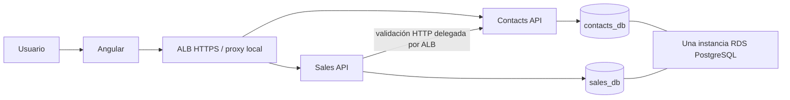

# Arquitectura propuesta ARCH-001 v1

Estado: aprobado el 2026-11-08. Leer [decisiones](decisions.md) y [aprobación](approval.md).

## Propósito y límites

EP01 requiere un CRM demostrable; EP02 exige contenedores, datos en RDS y entrega independiente.
Dos APIs cubren esos límites sin fragmentar un CRUD pequeño en muchos servicios:

- **Contacts API:** HU01 y HU02. Autenticación, cuentas precargadas, contactos y directorio de referencias.
- **Sales API:** HU03 a HU07. Oportunidades, etapas, cierre, agenda, interacciones y agregados del dashboard.
- **Web Angular:** HU01 a HU08. Experiencia de usuario e integración de los dos contratos.

HU09 concreta límites/datos; HU10 empaqueta; HU11 despliega; HU12 automatiza; HU13 demuestra.
No se implementan HU14/HU15 ni se convierten en dependencias ocultas.



La flecha Sales→Contacts es lógica: en AWS atraviesa la ruta Contacts del mismo ALB; no hay referencia
de ensamblados ni lectura de tablas ajenas. Las consultas propias de Sales continúan si Contacts falla;
los comandos que necesiten validar referencias fallan con 503 sin escribir. Ver [contratos](api-contracts.md).

## Tecnologías y líneas seleccionadas

| Elemento | Selección propuesta | Razón |
|---|---|---|
| Plataforma | .NET / ASP.NET Core **10.0 LTS**, C# 14, `net10.0` | Soporte vigente; evitar iniciar en .NET 8 próximo a fin de soporte |
| Persistencia | EF Core **10.0.x**, Npgsql EF provider **10.0.x** | Misma familia mayor, acceso PostgreSQL sin ORM adicional |
| Base | PostgreSQL **17.x** local y RDS | Relacional, compatible con Npgsql, sin necesidad de licencia SQL Server |
| Frontend | Angular/CLI/Material/CDK **22.0.x** alineados | Línea estable compatible documentada; standalone y controles accesibles |
| Build frontend | Node **24 LTS, >=24.15.0 <25**; npm 11.x; TypeScript **6.0.x** | Rango compatible con Angular 22.0 |
| Reactividad | Signals y RxJS **7.8.x** | Estado local y HTTP; sin store adicional |
| API | REST JSON, OpenAPI **3.1.0** publicado desde ASP.NET Core OpenAPI 10 | Formato nativo .NET 10 compatible con generación TypeScript |
| Fechas Angular | Luxon **3.x** y tipos 3.x, solo en helper compartido | Convertir datetime-local en America/Bogota sin depender de zona del dispositivo |
| Backend tests | xUnit **2.9.x**, VSTest, `Microsoft.NET.Test.Sdk` compatible; Testcontainers.PostgreSql **4.x** | Herramientas de pruebas, sin dependencias de aplicación |
| Frontend tests | Vitest de la configuración oficial Angular 22; Playwright **1.x** para E2E | Componentes/formularios y flujos reales |
| Contenedores | Linux amd64, Docker/Compose v2; imágenes oficiales .NET 10 Ubuntu Noble, PostgreSQL 17 | RDS usa mismo major; ICU/tzdata para America/Bogota |
| Infraestructura | ECS Fargate, ALB, ECR, RDS, CloudWatch, S3, CodePipeline, CodeDeploy; CloudFormation | Servicios del entregable y configuración reproducible |

**Política de parches:** al iniciar el bootstrap aprobado, resolver el parche estable más reciente dentro
de estas líneas contra fuentes oficiales; registrar números exactos en `docs/toolchain-lock.md`,
`global.json`, `Directory.Packages.props`, lockfiles NuGet y npm e imágenes por digest. No usar rangos
flotantes en builds finales. Fijar el SDK .NET 10 estable que incluya esos parches. Ajustes de parche
compatibles son rutina; cambios de major/minor elegidos o peer dependencies incompatibles requieren ADR.
El inventario local no es el lock y no se ha probado aún la combinación instalada.

Fuentes verificadas el 2026-11-08: [soporte .NET](https://dotnet.microsoft.com/en-us/platform/support/policy/dotnet-core),
[compatibilidad Angular](https://angular.dev/reference/versions), [soporte Angular](https://angular.dev/reference/releases),
[Npgsql 10](https://www.npgsql.org/efcore/release-notes/10.0.html),
[RDS PostgreSQL](https://docs.aws.amazon.com/AmazonRDS/latest/PostgreSQLReleaseNotes/postgresql-versions.html).

## Estructura prevista (aún no creada)

```text
SmartSales.slnx
global.json / Directory.Build.props / Directory.Packages.props / .editorconfig
src/
  Contacts/SmartSales.Contacts.Api/
    Api/{Endpoints,Filters,Middleware}/
    Application/{Auth,Contacts,Directory}/    # casos de uso y sus DTO
    Domain/{Entities,Rules,Enums}/
    Infrastructure/{Persistence,Security}/   # DbContext, configuraciones, Migrations
  Sales/SmartSales.Sales.Api/
    Api/{Endpoints,Filters,Middleware}/
    Application/{Opportunities,FollowUps,Interactions,Dashboard}/
    Domain/{Entities,Rules,Enums}/
    Infrastructure/{Persistence,ContactsDirectory}/
  Web/                                      # workspace Angular único
tests/{Contacts.UnitTests,Contacts.IntegrationTests,Sales.UnitTests,Sales.IntegrationTests,e2e}/
contracts/                                 # export OpenAPI por servicio, después del bootstrap
infra/cloudformation/                       # plantillas por red/datos/app/entrega
deploy/{contacts,sales,web}/                # taskdef/AppSpec/plantillas, sin secretos
pipelines/                                 # CI Azure Repos → releases AWS
docs/                                      # referencia técnica y progreso
```

## Capas y dependencias

Un `.csproj` por API, más proyectos de pruebas. No crear cuatro ensamblados por API para este tamaño.

| Carpeta | Responsabilidad | Dependencias permitidas |
|---|---|---|
| Api | Rutas, binding, autorización, HTTP/ProblemDetails y DI | Application; Infrastructure únicamente para registrar servicios |
| Application | Casos de uso, validaciones de negocio, DTO, transacciones | Domain, DbContext/cliente específico de Infrastructure y APIs EF necesarias |
| Domain | Entidades y reglas puras de estado/fechas/importes | BCL; sin ASP.NET, EF, red o reloj estático |
| Infrastructure | Mapeos EF, migraciones, hash/JWT, cliente Contacts | Domain y bibliotecas técnicas; no Api ni casos de uso de Application |

Se acepta explícitamente que Application use el DbContext concreto: es una arquitectura por capas
pragmática, no una implementación de Clean Architecture. No envolver EF en un repositorio genérico.
Los DTO viven con su caso de uso, no en Api, para evitar dependencia Application→Api. El cliente externo
define sus modelos técnicos dentro de Infrastructure y el caso de uso los traduce.

Endpoints delgados agrupados por funcionalidad; un servicio/caso de uso concreto por operación cohesionada.
Mapeo manual; validación de forma con capacidades de ASP.NET/DataAnnotations y reglas de dominio explícitas.
`IExceptionHandler` + `ProblemDetails` centraliza fallos. `ILogger` JSON y `Activity`/traceId, sin stack en HTTP.
Tiempo inyectado con `TimeProvider`; consultas de lectura con `AsNoTracking`, proyección y cancelación.

## Integración y evolución

- Contratos y autorización están en [api-contracts](api-contracts.md) y [security](security.md).
- Sin CRUD ni borrado de usuarios; sin borrado de contactos. Esto mantiene estables las referencias externas.
- No hay transacciones distribuidas: validar referencias primero, luego transacción local en Sales.
- Web compone contacto+actividad en dos consultas y muestra fallo parcial de actividad sin perder la ficha.
- Evitar N+1: lookup de nombres por lotes; ningún dato comercial duplicado en otra base.
- Una API puede actualizarse sin cambiar la otra si conserva contrato v1 y claves públicas JWT.
- OpenAPI se exporta en CI. Tipos TypeScript se generan como artefacto de desarrollo; servicios HTTP
  Angular siguen escritos por feature, sin cliente gigantesco ni segundo modelo manual divergente.
- RDS es un fallo compartido aceptado para el laboratorio, no una afirmación de alta disponibilidad.

## Patrones elegidos y evitados

Usar DI nativa, casos de uso concretos, DTO, validación explícita, transacción local, concurrencia optimista,
cliente HTTP tipado, ProblemDetails y componentes Angular reutilizables. Usar async solo cuando exista I/O.
Evitar CQRS/MediatR, repositorios genéricos, event sourcing, bus de mensajes, microservicio por entidad,
API Gateway/BFF propios, NgRx, AutoMapper y bibliotecas de gráficos para un solo gráfico sencillo.
No agregar una abstracción «por si acaso»; justificarla con una HU y aprobarla si cambia esta referencia.

## Convenciones de desarrollo y configuración

- UTF-8 y LF; C# con 4 espacios, TypeScript/HTML/SCSS con 2. Configurar `.editorconfig` al bootstrap.
  Namespace raíz `SmartSales.Contacts` / `SmartSales.Sales`. PascalCase en tipos/miembros C#,
  camelCase en variables/JSON/TypeScript y sufijo Async en métodos de I/O C#.
- Nullable habilitado, warnings propios tratados como errores una vez limpio el scaffold; TypeScript
  strict y noUncheckedIndexedAccess. No `any` para ignorar un contrato ni supresiones globales de warnings.
- DbContext y casos de uso scoped; no compartir un DbContext entre tareas concurrentes ni convertirlo
  en singleton. Transacciones cortas, sin mantener una transacción abierta durante una llamada HTTP.
- Cliente HTTP tipado mediante IHttpClientFactory. Bearer/traceparent por HttpRequestMessage;
  nunca almacenar el token de un usuario en DefaultRequestHeaders compartidos. Propagar CancellationToken.
- Validar DTO de entrada, después reglas/autorización/estado, después persistir. No devolver entidades EF,
  propiedades de seguridad o navegación cíclica. No agregar FluentValidation/AutoMapper sin ADR que lo justifique.
- GET sin efectos de negocio; comandos devuelven el recurso persistido. Validar filtros con lista permitida.
  Escapar `%`, `_` y backslash al construir patrón de búsqueda literal y enviar el patrón parametrizado a EF.
- Angular usa bases **relativas** C y S en todos los ambientes; proxy local y ALB resuelven host.
  Una imagen Web sirve en distintos ambientes, sin secretos ni URL AWS compilada. No necesita un
  config.js global para estos dos paths fijos. Sales sí recibe ContactsBaseUrl por configuración externa.
- Puertos locales previstos: Contacts HTTPS 7101, Sales HTTPS 7102 y Angular HTTPS 4200; proxy Angular
  conserva path. En Compose ambos backend8080 en hosts separados y Web8080; la red Docker resuelve nombres.
  Excepciones de certificado de proxy solo en Development, nunca en HttpClient de despliegue.
- Producción/Demo: env vars sobre appsettings sin secretos; configuración requerida validada al iniciar,
  sin defaults de contraseña, clave o base remota. Registrar ambiente y versión sin revelar configuración sensible.
- Usar las pruebas de `testing.md` para cada cambio. Contrato modificado implica revisar consumidores,
  tipos generados y evidencia; refactor interno no debe alterar respuesta HTTP accidentalmente.
- Al autorizarse trabajo Git: rama acotada a HU, cambios pequeños y referencia `AB#<id>` para trazabilidad.
  No hacer commit/push, PR ni merge por iniciativa propia. Un agente entrega estado de trabajo y evidencias.
