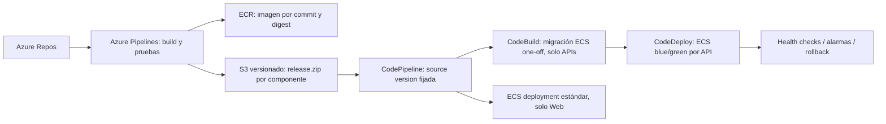

# AWS y entrega continua — ARCH-001 v1

Diseño aprobado para HU09–HU13, sin recursos creados. La guía 181128 fue aportada por el usuario;
su alcance aplicable está en [resumen](source/lab-guide-summary.md). G-02..G-04 de [decisiones](decisions.md)
se comprueban antes de aprovisionar. Prioridad: proyecto propio operativo en microservicios.

## Topología académica

Una región permitida por el laboratorio. VPC con dos subredes públicas en AZ distintas para ALB y tareas
Fargate, y dos subredes privadas para DB subnet group RDS. Una tarea por servicio: Contacts, Sales y Web.
RDS PostgreSQL 17 Single-AZ, tamaño micro permitido y almacenamiento inicial 20 GiB; confirmar disponibilidad
y precio real antes de aprovisionar. Fargate inicial por tarea 0.25 vCPU/512 MiB; medir y ajustar recursos.

**Decisión deliberada:** tareas Fargate en subred pública con public IP para salida a ECR/SSM/CloudWatch,
sin NAT Gateway. Su security group admite8080 **solo desde el SG del ALB**; tener IP no habilita acceso
directo desde Internet. RDS no tiene IP pública;5432 solo desde SG de las tareas pertinentes.
Es una reducción de costo/infraestructura para la demostración; entorno productivo requeriría revisar
egress, subredes privadas, endpoints y disponibilidad. No afirmar aislamiento físico entre bases de una instancia.

ALB HTTPS 443 con certificado ACM y dominio aprobado.80 solo redirige443; no recibe login en HTTP.
Reglas por path, sin quitar prefijo:

| Path | Destino |
|---|---|
| `/api/contacts/*` | Contacts, target group activo del par A/B |
| `/api/sales/*` | Sales, target group activo del par A/B |
| Cualquier otro | Web/Nginx, fallback index.html para rutas Angular |

Health checks de APIs usan sus `/api/<servicio>/health/ready` (e.g. `/api/contacts/health/ready` y `/api/sales/health/ready` sin prefijo /v1/, alineado con implementación real de Kestrel y tests locales); Web `/healthz`. Assets con hash pueden
cachearse; index.html no. Nginx escucha8080 como usuario no root. SPA solo devuelve index en rutas
de navegación, no transforma un404 de `/api/*` en HTML. Backend Kestrel8080, cierre graceful en SIGTERM.

Sales usa la URL HTTPS de ese mismo ALB para llegar a Contacts; HTTPS y Bearer conservan el contrato.
Se acepta una vuelta por el ALB y su latencia para evitar otro balanceador/discovery. La URL es configuración,
no está compilada. En desarrollo usa DNS de Compose. No introducir Service Connect, Cloud Map, service mesh
ni un gateway propio. **Service Connect no admite blue/green controlado por CodeDeploy**; no confundirlo
con blue/green nativo ECS, que es otra estrategia y requeriría cambiar ADR-07.

## Roles, secretos y configuración

Usar roles existentes permitidos por AWS Academy; no asumir que se puede crear IAM libremente.
Separar execution role (imagen, logs y secrets de tarea), task role de app y roles de CodeBuild/CodeDeploy/
CodePipeline cuando el laboratorio lo permita. Si solo existe LabRole amplio, registrar esa limitación y
su riesgo en G-02; no declarar mínimo privilegio logrado. Las APIs no necesitan AWS API para su CRUD.

Parámetros externos: conexión runtime propia, conexión migrador solo para tarea de migración, clave JWT
privada solo Contacts, claves públicas/issuer/audience en ambas, base URL Contacts solo Sales, ambiente
Demo, CORS local y seeds explícitos. SSM SecureString como mecanismo primario; validar permisos KMS/SSM.
Secretos nunca en plantilla, manifiesto de release, imagen, Terraform state, Git o logs.

RDS requiere certificado CA oficial y conexión VerifyFull. Comprobar que ambos usuarios no conectan a la
base ajena. El master aprovisiona bases/roles de forma administrativa autorizada, fuera de tareas runtime.
Backup mínimo 1 día y cifrado habilitado si el laboratorio lo permite; disponibilidad y borrado son decisiones
de costo. CloudFormation retiene la DB por defecto; limpieza posterior requiere autorización y plan de datos.

## Infraestructura como documentación ejecutable futura

CloudFormation YAML, cuatro unidades: red; datos; servicios/ALB; entrega/logs. Parámetros para región,
subnets, certificado/dominio, roles existentes, tamaños, nombres y ARN de secrets. Revisar change set antes
de desplegar. No poner credenciales en outputs. Versionar plantillas y registrar stack/release en HU11.
No hay plantillas ejecutables creadas en esta fase.

CodeDeploy pasa a controlar el target activo de cada regla tras el primer despliegue. Los releases de código
no reaplican el stack de red/ALB. Un cambio de infraestructura posterior debe consultar el target group
del task set PRIMARY y reconciliarlo con los parámetros/reglas antes de ejecutar el change set; no volver
ciegamente al target A de la plantilla inicial ni deshacer un cambio de tráfico sano por drift.

## Puente determinista Azure Repos → AWS

No existe en este diseño una conexión nativa supuesta de CodePipeline a Azure Repos.

1. CI por path ejecuta restore/build/pruebas de componentes afectados. Cambios comunes/contratos disparan
   verificación de consumidores. Un build o test fallido impide producir release desplegable.
2. Publicar imagen ECR con tag SHA; registrar digest inmutable. Construir una sola vez, desplegar esa imagen.
3. Crear release ZIP por componente con `release.json` (componente, commit, digest, hashes de archivos,
   versión de contrato), `taskdef.json`, `appspec.yaml` para APIs y plantilla de tarea de migración.
   taskdef contiene imagen por digest, y AppSpec usa placeholder de TASK_DEFINITION. Web produce su
   `imagedefinitions.json`. Artefactos sin secretos, firmados por permisos de publicación y checksums.
4. S3 con versioning: key estable `releases/<component>/release.zip`; capturar VersionId de PutObject.
   Deshabilitar polling y triggers duplicados. CI inicia CodePipeline con source revision
   `S3_OBJECT_VERSION_ID` igual a ese VersionId. No desplegar «la última» versión que pudiera cambiar.
5. Pipeline independiente por componente, ejecución QUEUED. SourceAction=`ReleaseSource`. API pipeline:
   S3 Source → CodeBuild PreDeploy → CodeDeployToECS. Web: S3 Source → ECS estándar. No se necesita un
   source ECR adicional: taskdef ya fija el digest. Un commit de Sales no actualiza versión de Contacts.
6. CodeBuild, sin Docker privilegiado ni acceso directo a SQL, valida manifiesto y arranca una tarea ECS
   one-off con el bundle EF de la imagen nueva y credenciales de migrador; espera exit0 antes de desplegar.
   No crear otro microservicio migrador permanente ni migrar al arrancar cada réplica.
7. CodeDeploy por API, dos target groups y listener productivo del ALB compartido con reglas por path
   identificables para cada par. Configuración inicial `CodeDeployDefault.ECSAllAtOnce`; comprobar salud
   del nuevo task set antes de mover tráfico, conservar anterior5 min y rollback automático ante fallo/alarma.
   Validar en laboratorio que el controlador resuelva correctamente la regla de cada par compartido;
   no permitir que una plantilla sustituya el default action del frontend. No usar Service Connect aquí.
8. Registrar commit→CI run→digest→S3 VersionId→pipeline execution→task definition→despliegue.
   Demo de fallo: nueva imagen con readiness fallida en una release controlada; tráfico anterior sigue sano.
   Restaurar configuración después. Rollback de app nunca ejecuta migraciones destructivas hacia atrás.

CodeBuild aquí orquesta la migración y es parte explícita de la propuesta. Si la rúbrica exige que también
compile imágenes, o exige CodeCommit/Cloud9 u otro servicio, registrar cambio antes de adaptar CI. No duplicar
builds por apariencia ni anunciar una pipeline cumplida sin ejecutarla.

Azure Pipelines necesita credenciales temporales del laboratorio o conexión federada autorizada. No asumir
que AWS Academy permita crear un proveedor OIDC. Credenciales de sesión incluyen token y vencen; guardarlas
solo como secrets del pipeline y renovar cuando corresponda. Un self-hosted agent no se instala ni registra
sin autorización. Sin agente/minutos/credenciales disponibles, HU12 queda bloqueada con la causa real.

## Operación y evidencia

- Logs JSON stdout→CloudWatch, retención propuesta 7 días. traceId, ruta, status, duración y código técnico;
  sin cuerpos comerciales. Métricas ALB 5xx, health y fallos de tareas para alarmas de despliegue.
- Liveness no depende de DB; readiness sí de DB propia, no del directorio. Permitir drain antes de detener.
- Demostrar actualización y escalado 1→2 de una API sin redesplegar la otra; volver a 1 tras evidencia.
  No afirmar autoscaling automático: el criterio pide independencia, no política automática.
- Sin HA prometida: una tarea y RDS Single-AZ son puntos de fallo aceptados en Demo. Blue/green necesita
  capacidad temporal adicional; revisar cuotas y créditos antes de la prueba.
- Estimar costo con región/horas reales: ALB,3 tareas, RDS 20 GiB, ECR/S3/logs/IP públicas y surge blue/green.
  Sin NAT Gateway ni segundo ALB; no se asume costo cero por ser educativo. Registrar cálculo antes de crear.
- Evidencias HU13: diagrama real, URL/versión, datos persistentes tras reemplazo de tarea, aislamiento DB,
  logs correlacionados, actualización independiente, rollback, matriz de rúbrica y pasos de limpieza.

Fuentes: [S3 source versionado](https://docs.aws.amazon.com/codepipeline/latest/userguide/action-reference-S3.html),
[source revision override](https://docs.aws.amazon.com/cli/latest/reference/codepipeline/start-pipeline-execution.html),
[acción CodeDeployToECS](https://docs.aws.amazon.com/codepipeline/latest/userguide/action-reference-ECSbluegreen.html),
[restricciones Service Connect](https://docs.aws.amazon.com/AmazonECS/latest/developerguide/service-connect-concepts-deploy.html).
