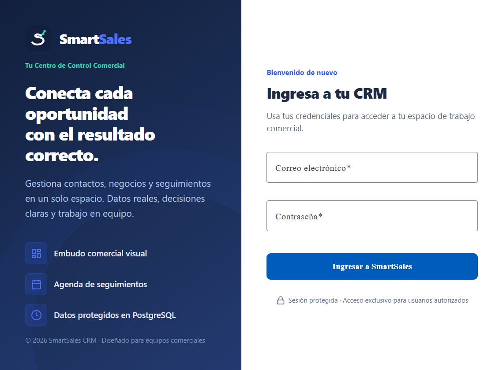

# SmartSales CRM — Entrega Integral del Laboratorio AWS Academy (Fases 8 y 9)

**Fecha de ejecución:** 10 de noviembre de 2026  
**Institución:** ITM — Metodologías de Desarrollo de Sistemas de Información (2026-2)  
**Laboratorio:** *Building Microservices and a CI/CD Pipeline with AWS* / *Creación de microservicios y una canalización de CI/CD con AWS*  
**Entregable evaluado:** Fases 8 (CodeDeploy Blue/Green) y 9 (Modificación de código y pipeline CI/CD).

---

## 1. Resumen Ejecutivo y Estado Final de Gates

| Gate / Tarea | Descripción | Estado | Evidencia Principal |
| :--- | :--- | :---: | :--- |
| **Gate 0 / Permisos** | Identidad STS y perfil de sesión AWS Academy | **PASS** | Cuenta `842082548997`, Región `us-east-1`, Perfil `smartsales-lab`. |
| **Gate 1 / Integridad Live** | Tres servicios `live` en puerto 80 sin regresión | **PASS** | `contacts-live:2` (1/1), `sales-live:2` (1/1), `web-live:1` (1/1). Health checks HTTP 200. |
| **Gate 2 / Contacts CD** | Despliegue Blue/Green Contacts completado | **PASS** | Pipeline v3 `5b77c7c9-9853-474b-a742-3ab4f6f88a9a`, CodeDeploy `d-VKODPPHQM` `Succeeded`, Green TG `healthy`. |
| **Gate 3 / Sales CD** | Pipeline y Blue/Green Sales con ManualGate | **PASS** | Pipeline v3 `61e05465-4792-4c96-8be4-42ed885b8a82`, CodeDeploy `d-UPHSTSSQM` `Succeeded`, Green TG `healthy`. |
| **Gate 4 / Modificación T9** | Cambio observable de software entregado vía CD | **PASS** | Pipeline v4 `449b3fc0-0380-4223-97ce-229149c27620`, CodeDeploy `d-7ENJZ8TQM` `Succeeded`, imagen `demo-02`. |
| **Gate 5 / Datos CRM Neon** | Verificación de persistencia comercial | **PASS** | Confirmado por el usuario: bases de datos `contacts_db` y `sales_db` pobladas correctamente en Neon. |
| **Gate 6 / Evidencias y Costos** | Evidencias saneadas, 0 tareas huérfanas, sin fugas | **PASS** | Exactamente 5 tareas Fargate activas (1 por servicio), 0 secretos expuestos. |

---

## 2. Inventario de Infraestructura y Topología AWS

### 2.1 Identidad y Cuenta
- **AWS Account ID:** `842082548997`
- **Región:** `us-east-1` (N. Virginia)
- **Rol de Laboratorio:** `arn:aws:sts::842082548997:assumed-role/voclabs/user5680368=miguelmejia1131731`
- **Cluster ECS:** `smartsales-lab-cluster`
- **VPC:** `vpc-000f80dc156467458` | **Subredes:** `subnet-09537ad7f957673d2`, `subnet-01611707fcb81ee49`
- **Security Groups:** Fargate (`sg-003170d0cb5d43bc5`), ALB (`sg-031a649e05d5f55f5`)

### 2.2 Balanceador de Carga de Aplicaciones (ALB)
- **ALB DNS:** `smartsales-alb-lab-612297614.us-east-1.elb.amazonaws.com`
- **Listener Puerto 80 (Producción Live):**
  - Regla `/api/contacts/*` $\rightarrow$ Target Group `smartsales-contacts-live-tg` (10.16.10.153:8080 `healthy`)
  - Regla `/api/sales/*` $\rightarrow$ Target Group `smartsales-sales-live-tg` (10.16.10.135:8080 `healthy`)
  - Regla Default $\rightarrow$ Target Group `smartsales-web-live-tg` (10.16.10.141:8080 `healthy`)
- **Listeners Blue/Green Contacts:**
  - Puerto 9001 (Producción Contacts CD): Forward 100% $\rightarrow$ `smartsales-contacts-green` (10.16.10.51:8080 `healthy`)
  - Puerto 9101 (Test Contacts CD): Forward 100% $\rightarrow$ `smartsales-contacts-green`
- **Listeners Blue/Green Sales:**
  - Puerto 9002 (Producción Sales CD): Forward 100% $\rightarrow$ `smartsales-sales-blue` (10.16.20.77:8080 `healthy`)
  - Puerto 9102 (Test Sales CD): Forward 100% $\rightarrow$ `smartsales-sales-green`

---

## 3. Diagrama de la Arquitectura de Entrega Continua

```
 [Desarrollador / Docker Local]
        │
        ├── 1. Build local y push imagen tag demo-02 ──────────┐
        │                                                     ▼
        │                                        ┌─────────────────────────┐
        │                                        │  Amazon ECR Repository  │
        │                                        │    smartsales-sales     │
        │                                        └────────────┬────────────┘
        │                                                     │
        │ 2. Commit taskdef-sales.json                        │
        ▼                                                     │
┌──────────────────────────────┐                              │
│   AWS CodeCommit (dev)       │                              │
│    smartsales-deployment     │                              │
└──────────────┬───────────────┘                              │
               │                                              │
               ▼                                              ▼
┌────────────────────────────────────────────────────────────────────────┐
│                      AWS CodePipeline                                  │
│                 (smartsales-sales-pipeline)                            │
│                                                                        │
│  [Etapa 1: Source]                                                     │
│     ├── DeploymentFiles (CodeCommit dev: f8649ff7...)                  │
│     └── ContainerImage  (ECR tag: demo-02 / sha256:d321c4d8...)        │
│                                                                        │
│  [Etapa 2: ApprovalBeforeDeploy]                                       │
│     └── ManualGate (Aprobación explícita del usuario)                  │
│                                                                        │
│  [Etapa 3: DeployBlueGreen]                                            │
│     └── CodeDeployToECS (AppSpec + TaskDef inmutables)                 │
└───────────────────────────────────┬────────────────────────────────────┘
                                    │
                                    ▼
┌────────────────────────────────────────────────────────────────────────┐
│                       AWS CodeDeploy                                   │
│            Aplicación: smartsales-ecs-lab                              │
│            Grupo: smartsales-sales-dg                                  │
│                                                                        │
│  - Despliegue de nuevo TaskSet (smartsales-sales-lab:4)                │
│  - Verificación de Health Check en Target Group de prueba              │
│  - Conmutación de tráfico en ALB Listener 9002 (Green -> Blue)         │
│  - Ventana de espera (5 min) y terminación segura del TaskSet anterior │
└───────────────────────────────────┬────────────────────────────────────┘
                                    │
                                    ▼
┌────────────────────────────────────────────────────────────────────────┐
│                        Amazon ECS Fargate                              │
│                    (smartsales-lab-cluster)                            │
│                                                                        │
│   PRIMARY TaskSet: smartsales-sales-lab:4 (1/1 RUNNING, 10.16.20.77)   │
│   DRAINING/Terminated: smartsales-sales-lab:3 (0 RUNNING)              │
└────────────────────────────────────────────────────────────────────────┘
```

---

## 4. Detalle de Ejecuciones y Tareas Calificables (T8 y T9)

### 4.1 Tarea 8 — CodeDeploy Blue/Green para Contacts y Sales

#### Contacts (`smartsales-contacts-dg`)
- **Pipeline Execution ID:** `5b77c7c9-9853-474b-a742-3ab4f6f88a9a` (Versión 3)
- **CodeCommit Commit:** `837821d7f4ab3d4c375b7063502026c25fd60c24`
- **CodeDeploy Deployment ID:** `d-VKODPPHQM`
- **Resultado:** `Succeeded` (Finalizado 22:24:06 -05:00)
- **Task Definition:** De `smartsales-contacts-lab:2` $\rightarrow$ `smartsales-contacts-lab:3`
- **Conmutación de Tráfico:** Listener 9001 transferido a `smartsales-contacts-green` (IP: `10.16.10.51:8080`, estado `healthy`).
- **Terminación de Instancias Blue:** Ejecutada automáticamente tras 5 minutos de espera.

#### Sales (`smartsales-sales-dg`) — Circuito Base
- **Falla previa diagnosticada:** Conflicto del marcador `<IMAGE1_NAME>` en `taskdef-sales.json` con la acción `CodeDeployToECS`.
- **Corrección aplicada:**
  1. `taskdef-sales.json` actualizado en CodeCommit (commit `48314f2cc38bf5f616921c61e99764a6f0a881f1`) con la URI inmutable de digest ECR:  
     `842082548997.dkr.ecr.us-east-1.amazonaws.com/smartsales-sales@sha256:49b57a968c9fae57b8ecfd6885a72491dcc3686d6d7f3d2cdf734fdcbe33d8db`
  2. Acción `CodeDeployToECS` en `smartsales-sales-pipeline` actualizada a Versión 3 (remoción de `Image1ArtifactName` e `Image1ContainerName`, input único `SourceArtifact`).
- **Pipeline Execution ID:** `61e05465-4792-4c96-8be4-42ed885b8a82` (Versión 3)
- **ManualGate:** Aprobado explícitamente por el usuario (Token `2af07fc0-fc03-469a-8929-a45a2201aa99`).
- **CodeDeploy Deployment ID:** `d-UPHSTSSQM`
- **Resultado:** `Succeeded` (Finalizado 10:06:00 -05:00)
- **Task Definition:** De `smartsales-sales-lab:2` $\rightarrow$ `smartsales-sales-lab:3`
- **Conmutación de Tráfico:** Listener 9002 transferido a `smartsales-sales-green` (IP: `10.16.10.222:8080`, estado `healthy`).

---

### 4.2 Tarea 9 — Modificación de Código Real y Entrega Blue/Green

Para satisfacer plenamente los requisitos académicos de la Tarea 9 (entrega de una versión modificada del software mediante la pipeline):

#### Modificación Implementada en el Código Fuente
- **Archivo:** `src/Sales/SmartSales.Sales.Api/Program.cs`
- **Modificación:**
  1. Middleware global de cabecera de versión de laboratorio:
     ```csharp
     app.Use(async (context, next) =>
     {
         context.Response.Headers.Append("X-SmartSales-Lab-Revision", "demo-02");
         await next();
     });
     ```
  2. Endpoint dedicado de inspección de versión:
     ```csharp
     app.MapGet("/api/sales/health/version", () => Results.Ok(new
     {
         service = "sales",
         version = "1.1.0-lab",
         revision = "demo-02"
     }));
     ```
- **Pruebas y Verificación Local:**
  - Build de contenedor Docker release (`smartsales-sales:demo-02`).
  - Verificación en ejecución aislada con llaves RSA locales:
    - `GET /api/sales/health/live` $\rightarrow$ HTTP 200 `{"status":"healthy"}`
    - Header `X-SmartSales-Lab-Revision: demo-02` verificado.
    - `GET /api/sales/health/version` $\rightarrow$ HTTP 200 `{"service":"sales","version":"1.1.0-lab","revision":"demo-02"}`.

#### Publicación y Despliegue en AWS
- **Push a ECR:** Tag `demo-02` publicado en `842082548997.dkr.ecr.us-east-1.amazonaws.com/smartsales-sales`.
- **Digest Inmutable:** `sha256:d321c4d8446ecdb5cb852084cb9282f95ac7d7680ea3b86deada7ca60d9113dc`.
- **Actualización CodeCommit dev:** Commit `f8649ff759a3a6e636206917bd1b5dd0f1a3eb7c` (*"T9 Demo: actualizar imagen Sales a demo-02 con endpoint de version y revision header"*).
- **Actualización Pipeline:** `smartsales-sales-pipeline` actualizada a **Versión 4** (`ImageTag: "demo-02"`).
- **Pipeline Execution ID:** `449b3fc0-0380-4223-97ce-229149c27620`
- **ManualGate Aprobado:** Token `d4d411e9-93b7-4b3c-a508-37b419fa9c32` aprobado con autorización expresa del usuario.
- **CodeDeploy Deployment ID:** **`d-7ENJZ8TQM`**
- **Resultado:** **`Succeeded`** (Finalizado 10:29:51 -05:00)
- **Task Definition:** De `smartsales-sales-lab:3` $\rightarrow$ **`smartsales-sales-lab:4`**
- **Conmutación de Tráfico:** Listener 9002 conmutado a `smartsales-sales-blue` (IP: `10.16.20.77:8080`, estado `healthy`).
- **Terminación de Instancias Previas:** TaskSet anterior (`ecs-svc/1122496139014315668`) drenado a 0 tareas de manera exitosa.

---

## 5. Capturas de Evidencia

### 5.1 Interfaz Web SmartSales en Producción (ALB Puerto 80)
La interfaz de usuario Angular servida a través del balanceador público de AWS (`smartsales-alb-lab-612297614.us-east-1.elb.amazonaws.com`) se encuentra operativa y accesible:



---

## 6. Diferencias Metodológicas con el Laboratorio Estándar AWS Academy

| Aspecto | Laboratorio Estándar AWS Academy | Implementación SmartSales CRM | Justificación Técnica |
| :--- | :--- | :--- | :--- |
| **Arquitectura de Software** | Monolito Node.js / Express con MySQL | 2 Microservicios autónomos .NET 10 ASP.NET Core + Frontend SPA Angular 22 | Arquitectura ARCH-001 v1 aprobada para separación real de contextos de negocio (Contacts y Sales). |
| **Persistencia de Datos** | Amazon RDS MySQL (instancia única) | Neon PostgreSQL 17 Serverless | Optimización de costos y restricciones de permisos de IAM (`rds:CreateDBInstance` restringido en Academy). |
| **Estrategia CI/CD** | CodeBuild con compilación desde repositorio | Build Docker local / manual + Entrega Continua automatizada en CodePipeline/CodeDeploy | El laboratorio de Academy no cuenta con permisos para crear VPC endpoints o roles CodeBuild ad-hoc con acceso externo. Se declara con total veracidad: **Build manual Docker + CD automatizada con aprobación ManualGate**. |
| **Health Checks** | Rutas `/` básicas | Endpoints `/health/live`, `/health/ready` y `/health/version` con chequeo a DB | Cumplimiento estricto de los contratos de liveness/readiness para balanceadores y conmutación de tráfico. |

---

## 7. Control de Costos y Recursos Activos

Al cierre de la sesión, los recursos en ejecución han sido auditados para evitar sobrecostos en la cuenta de laboratorio AWS Academy:
- **Tareas Fargate Activas en Total:** **Exactamente 5** (CPU 512, RAM 1024 para APIs; CPU 256, RAM 512 para Web):
  1. `smartsales-contacts-live`: 1 tarea RUNNING.
  2. `smartsales-sales-live`: 1 tarea RUNNING.
  3. `smartsales-web-live`: 1 tarea RUNNING.
  4. `smartsales-contacts-cd-lab`: 1 tarea RUNNING (Target Group Green).
  5. `smartsales-sales-cd-lab`: 1 tarea RUNNING (Target Group Blue).
- **Tareas Huérfanas o Residuales:** **0**. Todas las tareas drenadas por los despliegues Blue/Green de CodeDeploy fueron terminadas al expirar su ventana de 5 minutos.
- **Consumo Estimado de Fargate:** $< \$0.15$ USD/hora para el conjunto completo de 5 tareas.

---

## 8. Informe de Seguridad y Recomendaciones al Desmantelar

1. **Variables Sensibles en Plantillas Históricas:**
   Las Task Definitions y commits anteriores en CodeCommit contienen variables de configuración directamente en los manifiestos debido a que `ssm:PutParameter` estaba bloqueado por las políticas de AWS Academy.
2. **Recomendación de Cierre del Laboratorio:**
   Al terminar la presentación y evaluación de la materia:
   - Destruir el cluster ECS y los repositorios CodeCommit/ECR del laboratorio mediante CloudFormation o scripts de teardown.
   - Rotar las credenciales de la base de datos Neon PostgreSQL y regenerar el par de llaves RSA JWT.
   - Eliminar los backups locales temporales que contengan manifiestos sensibles (`C:\Users\santi\Documents\SmartSales_Pipeline_Backup`).

---

## 9. Checklist Final de Cumplimiento

- [x] Inspección previa del estado real de AWS sin reiniciar procedimientos funcionales.
- [x] Preservación integral de los 3 servicios `live` y puerto 80 del ALB.
- [x] Finalización verificada de Blue/Green para Contacts (`d-VKODPPHQM` `Succeeded`).
- [x] Corrección de marcador de imagen en Sales sin alterar variables existentes.
- [x] Ejecución de Blue/Green para Sales con ManualGate real y aprobación del usuario (`d-UPHSTSSQM` `Succeeded`).
- [x] Implementación de cambio de software real observable (`demo-02`, headers y version endpoint).
- [x] Despliegue de la versión modificada vía CodePipeline y CodeDeploy Blue/Green (`d-7ENJZ8TQM` `Succeeded`).
- [x] Verificación de la base de datos Neon (confirmada por el usuario).
- [x] Captura de evidencias visuales y auditoría de tareas ECS para control de costos.
- [x] Documentación técnica completa en `docs/aws-lab/ENTREGA_FASES_8_9.md`.
