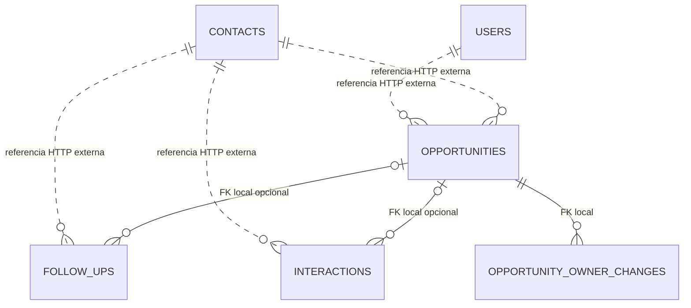

# Modelo de datos — ARCH-001 v1

Arquitectura aprobada el 2026-11-08. Límites y catálogos que el backlog no fijaba son decisiones P-02/P-03
aceptadas entonces. Todas las tablas se justifican por las HU indicadas.

## Convenciones

- Una instancia PostgreSQL 17; bases `contacts_db` y `sales_db`, schema `public` de cada una.
- Identificadores UUID generados por aplicación; C# `Guid`, JSON string. Nombres SQL snake_case,
  clases/propiedades PascalCase; mapeo explícito con Fluent API, sin paquete adicional para renombrar.
  Usar `Guid.CreateVersion7()` al crear entidades; UUID de seeds son constantes. Configurar Npgsql para
  PostgreSQL 17 explícitamente (`SetPostgresVersion(17,0)`); no introducir funciones exclusivas de PostgreSQL 18.
- Instantes: `timestamptz`, `DateTimeOffset` normalizado a UTC; representación JSON ISO 8601 con `Z`.
  Fecha esperada de cierre: `date` / `DateOnly` / `YYYY-MM-DD`, sin conversión de zona.
- Importes `numeric(14,2)` / `decimal`, COP. Rango propuesto 0..999999999999.99; rechazar más de
  dos decimales en entrada, sin redondeo silencioso. Los agregados se calculan en backend, no en JavaScript.
- `version bigint NOT NULL DEFAULT 1` en Contact, Opportunity y FollowUp, concurrency token EF.
  Cada actualización aumenta exactamente uno; conflicto → 409. Nunca usar reloj como versión.
- Enums como varchar con `CHECK` y valores wire de los contratos; no depender de ordinales C#.
- Texto plano, trim y Unicode NFC; vacíos opcionales → null. Sin HTML ingresado por usuarios.
- No soft delete ni `is_deleted` sin HU que lo exija. No hay endpoints de borrado.

## Contacts API — contacts_db

### users — HU01, directorio HU03/HU05

| Columna | Tipo / nulabilidad | Regla |
|---|---|---|
| id | uuid PK | Cuenta precargada, estable |
| display_name | varchar(120) NOT NULL | Nombre visible |
| email | varchar(254) NOT NULL | Dirección de acceso válida |
| normalized_email | varchar(254) NOT NULL UNIQUE | Trim + NFC + `ToUpperInvariant` |
| password_hash | text NOT NULL | `IPasswordHasher<User>` de ASP.NET; nunca hash propio |
| role | varchar(20) NOT NULL | `Administrator` o `Commercial` |
| is_active | boolean NOT NULL | Solo activas pueden iniciar sesión o recibir asignación |
| created_at | timestamptz NOT NULL | UTC, fecha de seed |

Sin tabla de roles, permisos dinámicos, refresh tokens ni perfiles de empresa. Dos roles fijos.
No agregar el esquema completo de ASP.NET Identity: solo su hasher para este alcance sin CRUD/MFA/reset.
No borrar usuarios; una cuenta inactiva conserva el identificador y sus referencias.

### contacts — HU02

| Columna | Tipo / nulabilidad | Regla |
|---|---|---|
| id | uuid PK | UUID estable, sin eliminación |
| name | varchar(160) NOT NULL | No vacío |
| type | varchar(20) NOT NULL | `Prospect` o `Customer` |
| email | varchar(254) NULL | Dirección válida cuando se informa |
| normalized_email | varchar(254) NULL | Trim + NFC + minúsculas invariantes |
| phone | varchar(40) NULL | Presentación ingresada |
| normalized_phone | varchar(20) NULL | Solo dígitos; 7..15 dígitos propuestos |
| source | varchar(20) NOT NULL | `Web`, `Referral`, `WhatsApp`, `Call`, `Other` |
| created_at / updated_at | timestamptz NOT NULL | UTC; updated_at inicialmente created_at |
| version | bigint NOT NULL | Concurrencia optimista |

`CHECK (normalized_email IS NOT NULL OR normalized_phone IS NOT NULL)` y controles de enums/longitudes.
Índices no únicos por normalized_email y normalized_phone: **duplicado es advertencia, no prohibición**.
Comparar email o teléfono normalizado, excluyendo el propio id al editar. No inferir país ni equiparar
un número nacional con uno internacional; evitar una regla de negocio oculta.
Nombre usa búsqueda parcial case-insensitive (`ILIKE` parametrizado). Con el volumen académico no se
agregan extensiones trigram ni motor de búsqueda; medir antes de justificar otro índice.

## Sales API — sales_db

### opportunities — HU03/HU04/HU07

| Columna | Tipo / nulabilidad | Regla |
|---|---|---|
| id | uuid PK | UUID |
| contact_id | uuid NOT NULL | Referencia externa Contacts; se valida antes de crear |
| title | varchar(160) NOT NULL | No vacío |
| estimated_amount | numeric(14,2) NOT NULL | >=0 |
| expected_close_date | date NOT NULL | Fecha válida; no se impone «futura» sin requisito |
| owner_user_id | uuid NOT NULL | Usuario activo al asignarlo; referencia externa |
| priority | varchar(10) NOT NULL | `High`, `Medium`, `Low`; default Medium |
| stage | varchar(20) NOT NULL | `New`, `Contacted`, `Proposal`, `Won`, `Lost` |
| created_by_user_id | uuid NOT NULL | Sub del JWT; puede diferir del responsable |
| created_at / updated_at | timestamptz NOT NULL | UTC |
| closed_at | timestamptz NULL | UTC, asignado por servidor al cierre |
| closed_by_user_id | uuid NULL | Actor del cierre |
| final_amount | numeric(14,2) NULL | Obligatorio y >=0 solo para Won |
| loss_reason | varchar(1000) NULL | Obligatorio, no vacío, solo para Lost |
| version | bigint NOT NULL | Concurrencia |

Estados abiertos = New/Contacted/Proposal. `CHECK` de cierre: abiertos tienen closed_at/closed_by/
final_amount/loss_reason nulos; Won tiene actor+instante+monto y loss_reason nulo; Lost tiene
actor+instante+motivo y final_amount nulo. No cerrar dos veces, reabrir ni editar cerradas.
`contact_id` es inmutable tras crear, propuesta P-02 para preservar las actividades asociadas.

Índices: `(stage, created_at, id)`; `(owner_user_id, priority, created_at, id)`;
`(contact_id, created_at, id)`; índice creado por PK. Clave alternativa `(id, contact_id)` para
integridad de las actividades locales. No crear índices adicionales sin consulta que los justifique.

### opportunity_owner_changes — trazabilidad HU03

`id uuid PK`, `opportunity_id uuid FK opportunities(id) NOT NULL`, `previous_owner_user_id uuid`,
`new_owner_user_id uuid`, `changed_by_user_id uuid`, `changed_at timestamptz`, todos NOT NULL.
Una fila por cambio efectivo, con previo != nuevo. Insertar en la misma transacción de reasignación.
Crear no produce una reasignación ficticia; el responsable inicial está en la oportunidad.
Índice `(opportunity_id, changed_at DESC, id)`; sin update/delete desde la aplicación.

### follow_ups — HU05

`id uuid PK`, `contact_id uuid NOT NULL` externo, `opportunity_id uuid NULL`, `subject varchar(160) NOT NULL`,
`scheduled_at timestamptz NOT NULL`, `owner_user_id uuid NOT NULL`, `status varchar(20) NOT NULL`,
`created_at timestamptz NOT NULL`, `completed_at timestamptz NULL`, `completed_by_user_id uuid NULL`,
`version bigint NOT NULL`.

Estado Pending o Completed; el primero tiene campos de finalización nulos, el segundo ambos informados.
Responsable siempre sub del creador, inmutable en el MVP. No agregar prioridad: la HU nueva simplifica
ese campo del backlog anterior. Una fecha pasada válida permite registrar un pendiente vencido;
no imponer restricción «solo futuro» que impediría esa situación.

FK compuesta `(opportunity_id, contact_id)` → opportunities `(id, contact_id)` con delete restrict:
si se informa una oportunidad, debe pertenecer al contacto. El contacto solo se valida por HTTP.
Índice `(owner_user_id, status, scheduled_at, id)` y `(contact_id, scheduled_at, id)`.

### interactions — HU06

`id uuid PK`, `contact_id uuid NOT NULL` externo, `opportunity_id uuid NULL`, `type varchar(20) NOT NULL`,
`occurred_at timestamptz NOT NULL`, `summary varchar(2000) NOT NULL`, `author_user_id uuid NOT NULL`,
`created_at timestamptz NOT NULL`.

Tipos Call/Email/Meeting. Solo append/read; no update/delete ni version innecesaria.
`occurred_at <= TimeProvider.GetUtcNow()` se valida en aplicación con reloj inyectado, no con CHECK
dependiente del tiempo. FK compuesta igual a follow_ups. Índices `(contact_id, occurred_at DESC, id)`
y `(opportunity_id, occurred_at DESC, id)`. Historial devuelve el mismo registro desde ambas fichas.

Los trazos externos son referencias lógicas; no representan FK entre bases.
No se almacenan contactos, nombres de usuarios ni entidades EF de Contacts en Sales.

## Escritura, transacciones e integridad

Crear una oportunidad: validar JWT/datos → consultar contacto y responsable → guardar oportunidad
en transacción local. Reasignar: rol Admin → abierta/version → usuario activo → actualizar e insertar
owner_change en una sola transacción. Si falla la validación remota, no iniciar escritura.
Cambiar etapa/cerrar/completar: operación local con versión, regla de estado y `SaveChangesAsync`.
Un conflicto concurrente revierte también la auditoría y devuelve 409; no reintentar automáticamente.

Validación previa externa no es una transacción distribuida. No existe borrado de contactos/usuarios
y no se agrega a este diseño. La desactivación manual de una cuenta después de asignar no borra el
histórico; volver a asignarla exige que esté activa. Cambiar esto requiere decisión nueva.

## Migraciones y usuarios PostgreSQL

- Un DbContext y carpeta de migraciones por API; tablas de historial separadas por base.
- Roles runtime `contacts_app` y `sales_app` con DML mínimo; roles migrador separados para DDL.
  Credencial master solo para bootstrap administrativo; nunca en tareas ECS de la app.
- Revocar CONNECT por defecto a PUBLIC en ambas bases; conceder solo a usuarios correspondientes.
  Revocar CREATE público y usar grants de tablas/secuencias apropiados. RDS master no es superusuario pleno.
- Una tarea de migración por servicio/release, antes de cambiar tráfico; bundle o comando de migración
  versionado. Nunca `EnsureCreated` ni `Database.Migrate` en el arranque normal.
- Expand/contract: agregar nullable/default compatible, desplegar lectores/escritores, posponer drops/renames
  a otra release aprobada tras retirar versión anterior. Rollback de app no intenta deshacer datos con `Down`.
- Seeds ficticios con UUID estables y upsert por id, habilitados solo en Development/Demo con bandera explícita;
  contraseñas de cuentas recibidas por secreto. Repetir no duplica ni pisa cambios comerciales existentes.
  Fixtures de pruebas se recrean en sus propias bases desechables, nunca en RDS de demostración.
